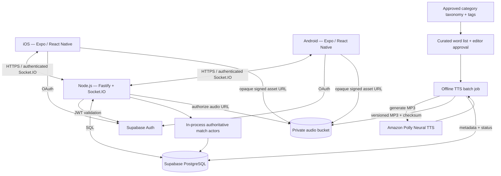
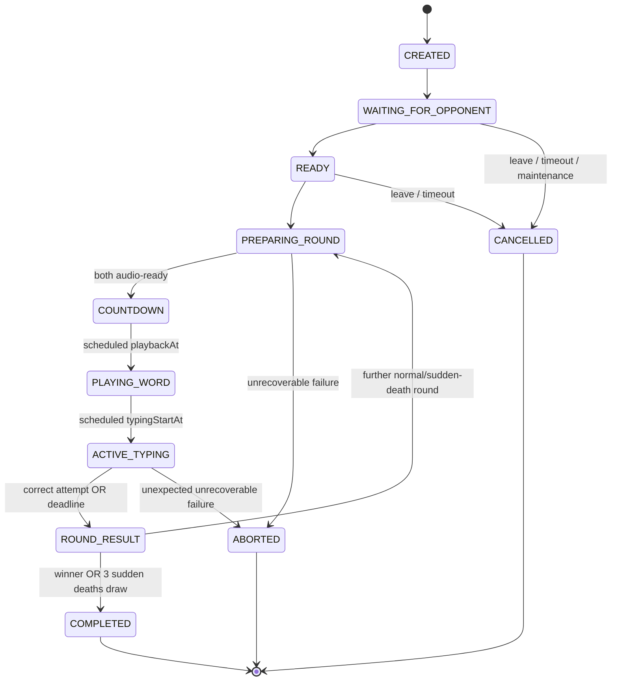

# TypeDuel — System Design v1.2

**Date:** October 25, 2026  
**Status:** Approved architecture baseline; V1 categories incorporated; playtest tuning remains open  
**Target platforms:** Android and iOS  
**Product reference:** TypeDuel PRD v0.4 (October 25, 2026), synchronized with this document.  
**Audience:** Founders, engineering team, Codex agent

## 1. Executive summary

TypeDuel is a synchronous two-player English spelling race for iOS and Android. Both players hear the **same prerecorded word** and race to submit its spelling. Version 1 includes **Classic** (selected difficulty stays fixed) and **Challenge** (both players start at Level 1 and progress together after a successful round). A standard match has **five rounds**. V1 category selections are **General (all approved words), Animals, Food, Sports, and Technology**. Public Quick Match uses General only; private friend rooms may choose any of the five, with the same category shared by both players for the whole match.

**Approved game rules:** each player can submit **at most three distinct answer attempts per round**, request **at most two additional audio replays per round**, and a tied five-round match proceeds to **at most three sudden-death rounds** before ending in a draw. The backend awards one point to the first server-validated correct answer, and closes that round. A replay never pauses or extends the typing deadline.

**Timing policy carried forward from v1.1:** the initial word is played first; only **after the scheduled clip finishes** does the server-authoritative typing timer begin. Round duration is configurable by difficulty; suggested initial playtesting values are in Section 5 and are **not yet measured or finalized launch values**.

**Architecture decision:** Category filters are catalog data, not separate services or player-specific difficulty. React Native + Expo on Android/iOS; TypeScript/Node.js with Fastify and Socket.IO; Supabase Auth + PostgreSQL; **Amazon Polly batch text-to-speech (TTS)** generating versioned MP3 files stored privately; an initial single-instance Render backend. Managed infrastructure, one authoritative match actor per game, and transactional outcomes. Do not add Redis/microservices for V1 without proven need.

**Trust boundary:** the mobile client does not choose secret words, validate answers, award points, advance levels, or choose timers. Client-submitted time and connectivity information are untrusted; synchronization improves the experience but cannot ensure perfectly equal network latency.

## 2. Architecture and trust boundaries



**Authority:** players authenticate with Supabase tokens. The server authorizes every API or socket action and validates every attempt. Only the server has access to correct spellings, word selection, internal audio-key mappings, and result transitions. Public errors and client snapshots omit this data until round results.

**Scope:** one backend *match owner* is assumed during live play. Deploy overlap is a special case: Render may run new and old processes concurrently, and an in-memory queue is **not** shareable. Section 13/18 mandate predeployment draining to zero active games and a shared maintenance gate; merely choosing "one instance" does not avoid rolling-deployment overlap.

## 3. Technology decisions

| Concern | Choice | Rationale / constraint |
|---|---|---|
| Mobile | Expo + React Native + TypeScript | Shared app, native keyboard/audio capabilities, real-device builds |
| Navigation | Expo Router | Deep links for invitations |
| Client state | TanStack Query + small UI/game store | Server snapshots remain authoritative |
| Backend | Node.js LTS + TypeScript + Fastify | APIs, health, auth, matchmaking, match actors |
| Real time | Socket.IO v4 (WebSocket preferred) | Acks and ordered transport; explicit recovery/snapshot required |
| Validation | Zod in shared `packages/contracts` | HTTP and socket contracts |
| Persistence | Supabase PostgreSQL + Drizzle | Database constraints and transactional scoring |
| Authentication | Supabase Auth | Apple, Google, Facebook; provider-dependent native flows |
| Category catalog | PostgreSQL `categories` + `word_categories` | General is a virtual all-words filter; four tagged categories share approved word/audio assets |
| Word audio generation | **Amazon Polly Neural TTS** via an offline TypeScript/Node batch CLI | Generate once; review; store and reuse MP3, not synthesize live during matches |
| Audio delivery | Private object bucket + short-lived opaque URLs | Same versioned recording for both players; explicit leakage trade-off |
| Backend host | One always-on Render web service | Initial process-owned live game state; controlled production deployments |
| Tests | Vitest + HTTP/socket integration + physical-device QA | Include timing, race, audio and deploy simulations |
| CI/mobile release | GitHub Actions + Expo EAS | Manual production approvals; signed iOS/Android artifacts |

Select compatible stable package versions during initial implementation, pin them in the lockfile, and verify SDK/provider constraints then. Avoid embedding any provider secrets or AWS credentials in the mobile app.

## 4. Monorepo layout

```text
typeduel/
  apps/
    mobile/
      app/                         # Expo Router routes
      src/features/{auth,match,category,profile}/
      src/audio/                   # preload, play, replay, diagnostics
    server/
      src/{http,socket,auth,db}/
      src/game/                    # authoritative state machine
      src/matchmaking/
      src/words/                   # server-only answers/audio-asset and category selection
      src/operations/              # maintenance gate, drain, restart recovery
  packages/
    contracts/                     # validated public HTTP/event schemas
    config/                        # shared TS/lint rules
  tools/
    word-audio/                    # Polly batch generation, checks, manifests
    word-editorial/                # lexicon, category taxonomy, tagging and approval utilities
  docs/
    PRD.md
    SYSTEM_DESIGN.md
    ARCHITECTURE_DECISIONS.md
  .github/workflows/
  AGENTS.md
  pnpm-workspace.yaml
```

Do not import server-only words, expected answers, provider credentials, or audio generation internals into the mobile app/public contracts.

## 5. Functional scope and finalized game rules (V1)

### Modes

- **Classic:** players select `difficulty = 1..5` in the lobby; this stays fixed for all normal and sudden-death rounds.
- **Challenge:** both start at Level 1. After a round with **at least one correct, accepted answer**, next level is `min(5, currentLevel + 1)`; after a scoreless round, stay at the same level. Applies in sudden death too. Both players always get the same word/level.

### V1 category policy (product-approved)

- The **five player-facing choices** are `general`, `animals`, `food`, `sports`, `technology`. The `general` option draws from all eligible approved English words, including untagged words; it is **not** an ordinary word tag. The four named topics require editorially approved tags. A word may belong to multiple named categories without duplicating its answer or audio.
- **Quick Match:** category is server-forced to `general`; the client presents a small non-editable “General” indication and does **not** create per-category public queues. Players still select Classic/Challenge; Classic also selects a difficulty.
- **Private friend room:** the host chooses any active category before inviting. Mode/category/(Classic difficulty) are **locked in the invitation** and shown to the invited player before accepting. Do not silently switch categories or widen the pool if the room has insufficient words.
- **Classic:** use the selected category and the chosen fixed difficulty for all rounds, including sudden death. **Challenge:** preserve the selected category throughout; after a correctly answered round, advance the shared level by one (max five). A scoreless round keeps the level.
- Match creation snapshots `category_id` and the category slug/version in the match, and an immutable `audio_asset_id` per round. Category changes in the admin catalog never rewrite ongoing match settings.
- A category/level must have at least **30 eligible approved words with approved audio** before public release; this is a configurable **editorial launch gate**, not a scientific difficulty threshold. At least eight nonrepeating candidates in any attainable difficulty pool is a hard runtime integrity precondition (maximum eight rounds total); if a pool is unexpectedly depleted, abort the room with a clear error **before starting** rather than reusing a word or revealing a hidden fallback. Enforce the stronger 30-word gate across all five levels for each named category at launch.
- Show only active/playable categories in friend setup; because all four named categories are promised for V1, populating and approving every required word pool is a **release blocker**. The prototype may use smaller seed pools in staging with an explicit environment-only override.
- Each game round chooses a uniformly random eligible word using a server-side secure random source from the match's **remaining unused words**; log only opaque selection IDs, not answers, in public/analytics paths. Other categories may overlap in the database, but a word cannot repeat within a single match.

### Approved per-round rules

- Exactly two players on different connected devices; **five normal rounds** and a three-second **first-round** countdown.
- Same versioned prerecorded English-word audio asset for both players; the spelling stays hidden until round result.
- **Initial spoken word plays before the typing clock starts.** During initial playback the server rejects answer submissions. The scheduled typing window begins after the verified configured clip duration (plus a small configurable safety margin).
- Each player receives **three answer-submission attempts per round**. A valid, distinct submission consumes one attempt even when incorrect. Duplicate retransmission with the same `attemptId` is idempotent and does not consume another attempt. Invalid authorization/shape errors are rejected rather than treated as gameplay attempts (rate-limit them separately).
- The first accepted correct answer **received and validated by the authoritative server** wins one point and closes the round. Wrong answers award zero and allow retry only while time and attempts remain. A closed round accepts no additional submissions.
- Each player may replay the word **two additional times** during the active typing window. Replays do not pause, reset, or extend the timer. The normal client enforces the count; replaying locally cached audio cannot be made tamper-proof against modified clients.
- If time expires without a correct answer, nobody scores. Higher score after normal round 5 wins.
- If tied after normal round 5, play **up to three sudden-death rounds**. Stop on the first round after which scores differ; if still tied after the third extra round, **record and display a draw**. Maximum **eight total rounds**.
- Disable autocorrect/suggestions/paste where supported; do not treat keyboard restrictions as a complete anti-cheat measure.

### Timing policy and word difficulty

The old v1.0 "8 seconds for every word" assumption is replaced by an **adjustable server-side duration per difficulty**. The following are **provisional playtest defaults** (not finalized launch values):

| Difficulty | Sample typing window after original audio ends |
|---|---:|
| 1 — Beginner | 8 s |
| 2 — Easy | 8 s |
| 3 — Medium | 10 s |
| 4 — Hard | 12 s |
| 5 — Expert | 15 s |

A configurable `typingDurationMsByLevel` is stored server-side and emitted for display after round preparation; no client-selected timer values. Validate these initial numbers with word-length distributions, completion rates, accessibility tests, and actual match play before the public release. PRD v0.4 reflects this post-audio, level-specific timing model.

### Text matching

Initial language: English. Normalize strings with Unicode NFC, whitespace trim, and case-insensitive comparison. Do not erase internal spaces, punctuation, accent differences, or arbitrary letters. Only editor-approved variants are accepted. Exclude ambiguous homophones, homographs with context-dependent pronunciations, and disputed spellings from the playable word pool.

## 6. Authoritative game-state machine



Active phases use server timestamps and a serialized **per-match actor** to avoid double winners. The client follows versioned `match.snapshot` and events: signed-out → home → mode / difficulty → queue/lobby → loading audio → countdown → listening → typing → round result → next round or final result. Do not infer scoring or level progression from local events.

`PLAYING_WORD` is **not** a typing phase. Replays are permitted *only* while `ACTIVE_TYPING`. Pre-round readiness failures cause a common reschedule or match cancellation, never an individualized extension of the round.

## 7. Matchmaking and rooms

**Quick Play:** authenticated users join a queue keyed by `{mode, difficulty?, region, category: "general"}`. The backend rejects attempts to queue with another category; Challenge has no selected level. Match two compatible players, atomically remove them from the in-process queue, create the match. One queue ticket/active game per user. No bots or skill-based matchmaking in V1.

**Private match:** creator selects mode, category, and Classic-only difficulty, receives an expiring opaque invite code/link, invites a second authenticated user, both mark ready. The invited player sees mode/category/difficulty before acceptance; settings are frozen once the invite is created. Reject self-join, full rooms, guess flooding, expired codes. Room capacity exactly two.

**Audio preflight:** before each round both clients preload the specific opaque clip and return `round.audio_ready` (telemetry/acknowledgment, not proof). The server only begins the shared countdown when both are ready; if either times out, reschedule/cancel **for both** without scoring.

**Maintenance rule:** when the shared production maintenance gate enters `DRAINING`, deny new queue joins and new private matches, cancel pending queues with a reason, and let existing matches finish when possible. See Sections 13 and 18.

## 8. Word catalog, automated audio generation, and synchronization

### 8.1 Offline audio-generation pipeline (required V1 functionality)

No founder/administrator must record each word. A **repeatable admin-only batch CLI** (`tools/word-audio/`) generates audio with Amazon Polly; Polly calls are **never on the live-match request path**.

1. Import a curated list of English words with canonical spelling, difficulty `1..5`, locale, editorial notes, permitted variants, and **proposed named-category tags**. Source vocabulary only from appropriately licensed material.
2. Normalize/deduplicate entries; validate category slugs and require **editor-approved tagging** rather than relying only on AI-assigned topic labels. Flag confusing homophones, ambiguous accents/readings, multiword entries, and offensive/inappropriate content; exclude or send to human review.
3. For `draft`/`needs_regeneration` words call Polly `SynthesizeSpeech` with a **configured fixed supported Neural voice**, `OutputFormat=mp3`, pinned locale, and controlled speech settings. Use SSML phoneme tags or a pronunciation lexicon for difficult readings where supported. Record `voiceId`, `engine`, `language`, lexicon version, generation config, and generated `audioVersion`.
4. Validate result format and nonempty output, measure actual decoded duration (not a guessed word-length formula), trim/standardize leading/trailing silence if necessary, normalize volume, generate SHA-256 checksum, and upload to private storage at a **random opaque key** such as `audio/{uuid}/{version}.mp3`.
5. Store the word-to-audio mapping and quality status in PostgreSQL. Provide a review CLI/page to **listen and approve**, reject, or regenerate clips. All Expert and flagged/ambiguous pronunciations require review. New items cannot enter matchmaking until both the word and exact audio version are `approved`.
6. Make generation **incremental and idempotent**: unchanged `{word, voice, SSML, config}` reuses its prior asset; failures may retry with bounded backoff; partial batches can resume. Avoid publishing half-completed batches. Keep a manifest/reconciliation report and per-batch costs/usage.
7. Only **approved assets with approved word metadata and valid category tags** are selectable; changes/replacements create a new immutable audio version so players already in an active match continue hearing the same asset. Validate each category × level candidate count daily and before enabling a category for private rooms.

A proposed editorial scale is roughly 5,000 words (~1,000/level), but the first prototype can use a much smaller reviewed seed set. Final bank size should depend on coverage, quality, and observed repetition—not a fixed API quota. One common US-English voice for V1; switching voice or accent needs renewed editorial validation.

**Official provider capabilities:** Polly supports MP3, SSML and custom pronunciation lexicons. Confirm the current provider terms and dictionary-content licenses before publishing assets. See Section 21.

### 8.2 Audio packaging and confidentiality

- `words`/answer data remain server-only. The device receives an opaque `roundId`, signed, short-lived access to one audio clip, asset duration/checksum metadata, and later a scheduled playback time; **never** the text or a semantic filename.
- Identical asset version for both players. Download and decode **before** the round countdown; cache temporarily in the app sandbox. Validate clip integrity and readiness to the extent the platform allows.
- A modified app can inspect, play, record or speech-recognize a supplied clip early. Signed URLs, unknown object names, or future key release mechanisms only *mitigate* this; they cannot promise perfect secrecy. Do not introduce encryption/key-release complexity until tested against actual latency and cheating risk.
- During `ACTIVE_TYPING`, the legitimate UI allows exactly **two extra local replays**; report replay telemetry to the server without waiting for a network ACK before starting the replay. Neither client nor server can reliably prevent offline playback by a modified client; don't rely on replay counts for tamper-resistant ranking.

### 8.3 Coordinated playback and opening of typing

1. Both players enter `PREPARING_ROUND`; server picks the word/audio version and sends `round.prepare` with `audioAccess`, `clipDurationMs`, `level` and `roundId`.
2. Each device preloads and decodes, then sends `round.audio_ready`; this is advisory. If readiness is late, **reschedule for both**, never create individual start/deadline offsets.
3. When both are ready, the server broadcasts `round.start` containing **three distinct authoritative timestamps**: `playbackAt` (after common countdown), `typingStartAt = playbackAt + clipDurationMs + configuredPlaybackMarginMs`, and `deadlineAt = typingStartAt + typingDurationMsByLevel[level]`.
4. Devices estimate server clock offset with ping/RTT observations and schedule initial playback at `playbackAt`. The typing field is locked during `PLAYING_WORD`; it opens at `typingStartAt`, and the visual timer displays time until `deadlineAt`.
5. Replays after `typingStartAt` never change `deadlineAt`; playback may run concurrently with entering text. A local audio interruption does not entitle one user to an automatic extension. Serious round-preparation failures reschedule **both**; mid-round failures are reported and investigated under explicit disconnection/abort policy, not a trust-on-first-complaint reset.
6. Record real playback start/end telemetry and skew on actual iOS/Android devices. Measured clip duration and the safety margin must reflect decoded playback behavior. Where start skew is excessive, delay or void the entire round under a common, monitored preflight policy; never adjust winners based solely on self-reported client playback timestamps.

**Operational default:** 3-second first countdown; allow an additional server-chosen preflight lead time (e.g. 1.5–3 seconds) once both are ready. These are tunable engineering defaults, not promises of subsecond absolute synchronicity across devices.

### 8.4 Category-aware word selection and coverage

`eligibleWordPool(categorySlug, level)` is evaluated **only on the server** against approved language, word status, active approved audio asset, difficulty, and (if category ≠ `general`) the `word_categories` join. Exclude the match's previous `word_id` values. Make the selection transactional with round creation; prevent selecting the same word twice in an eight-round match even if two state transitions race.

- **General:** no category join/filter; all approved English words across topics are eligible at the requested level.
- **Named category:** require an `approved` membership for that word/category and an active, eligible category. Do not expose word counts so precisely that a tiny category pool becomes an answer side channel.
- **Coverage audit:** matrix of five categories × five levels showing counts of approved playable words, verified audio, pending editorial reviews, ambiguous/homophone rejects, and recently used words. A release check fails if any named category × level has fewer than 30 playable words.
- **Content maintenance:** change tags without re-running Polly when spelling/pronunciation/audio are unchanged; add category-specific replacement words without redeploying the app; preserve a consistent `category_id` on historical matches.
- **Determinism:** tie the selected word/audio version to a persisted `match_rounds` record before broadcasting `round.prepare`. Only one word/audio version is valid for both clients.

## 9. Authoritative timing, attempts, and fairness

### 9.1 Server timeline and attempt validation

Backend uses a **monotonic clock** for in-process elapsed time, with UTC timestamps for snapshots and durable audit. It computes and persists `playbackAt`, `typingStartAt`, and `deadlineAt`; no player-supplied timestamp can move a deadline or win a race.

For each `answer.submit({matchId, roundId, attemptId, text})`, the match actor performs:

1. Authenticate/authorize the player, exact match, and current round; validate payload size/shape.
2. If `attemptId` was already processed, return the prior outcome without consuming another attempt (idempotency).
3. Require match phase `ACTIVE_TYPING` and **server receipt** in the `[typingStartAt, deadlineAt)` window; reject before/after (no retroactive answers).
4. Ensure this user has fewer than **3 counted distinct valid submissions** for the round; otherwise reject `ATTEMPTS_EXHAUSTED`.
5. Increment the user's attempt count, normalize and compare to the server-only answer/approved variants.
6. If incorrect, return `INCORRECT` and remaining-attempt count (never leak the answer).
7. If correct and still open, serialize and atomically commit the round winner, score, and next difficulty. After successful DB commit, broadcast `round.result` and advance. A second correct submission cannot score after closure.

Late retries do not consume an extra attempt; invalid/unauthorized floods are independently rate limited. The round closes either on one correct submission or `deadlineAt`. If neither submits correctly before deadline, record zero scores and Challenge level unchanged.

### 9.2 Latency fairness baseline (V1)

- First **correct, server-received** attempt wins; this is a deterministic, auditable rule, but it favors lower one-way network delay in close races.
- Collect bounded RTT/jitter samples during lobby and match, clock-offset estimate, audio-start skew, and server-received-at difference between close valid attempts. Expose only aggregate fair-play analytics, not exploitable private opponent signals.
- Test both players on comparable networks and asymmetrical/high-latency mobile conditions. Determine acceptable network-quality ranges for Quick Play; make degraded network quality visible without falsely guaranteeing equal opportunity.
- **Near-tie rule is not automatically applied in V1:** before adding latency compensation or a tie window, define an anti-manipulation threat model, choose thresholds using actual observations, and simulate exploit attempts. Never order outcomes by device-submitted timestamps.
- Keep transaction and actor result idempotent across duplicate sockets, retry messages, reconnections, and simultaneous submissions.

## 10. HTTP API (V1)

Base: `/v1`, authenticated with Supabase access JWT unless marked public. Return typed, validated JSON. HTTP manages user data and setup; Socket.IO manages active gameplay.

| Method | Route | Behavior |
|---|---|---|
| GET | `/health/live` | Process is alive (public) |
| GET | `/health/ready` | Database/readiness checks (restricted or sanitized) |
| GET | `/v1/me` | Current profile and aggregate stats |
| PATCH | `/v1/me` | Update display name/avatar URL (validated, moderated as needed) |
| DELETE | `/v1/me` | Initiate account deletion and revoke access |
| GET | `/v1/categories` | List active categories, localized label/icon, availability; `general` always default |
| GET | `/v1/matches?limit=20&cursor=...` | User's completed match history |
| GET | `/v1/matches/:id` | User-authorized match summary; no live answer leakage |
| POST | `/v1/rooms` | Create private match with immutable `{mode, categorySlug, difficulty?}`; validate category coverage |
| POST | `/v1/rooms/:code/join` | Join room with auth/room constraints |
| DELETE | `/v1/rooms/:code` | Owner leaves/cancels before game starts |

Use standard error envelope: `{ code, message, requestId }`; define `401`, `403`, `404`, `409`, `422`, `429` patterns. Never include internals or answer text in error responses.

## 11. WebSocket event protocol

Authenticated namespace: `/game`. Verify Supabase access JWT during handshake and on token renewal/reconnect. Use schema validation, user/match authorization, rate limiting, per-round idempotency, and monotonic `stateVersion` in every authoritative transition. Socket.IO preserves delivered-event order but defaults to **at-most-once** delivery; clients must request canonical snapshots after reconnect/gaps.

| Direction | Event | Payload / semantics |
|---|---|---|
| Client → server | `queue.join`, `queue.leave` | `{mode, difficulty?, categorySlug?: "general"}`; backend forces General; ACK queued / cancelled / maintenance |
| Client → server | `lobby.ready` | `{matchId, ready}` |
| Server → client | `match.found` / `match.snapshot` | Match identity, `{mode, categorySlug, difficulty?}`, sanitized full state with version |
| Server → client | `round.prepare` | `{roundId, level, categorySlug, audioAccess, clipDurationMs, preparationDeadline, audioVersion}` — **no answer** |
| Client → server | `round.audio_ready` | `{roundId, assetVersion}` — advisory preflight ACK |
| Server → client | `round.start` | `{roundId, playbackAt, typingStartAt, deadlineAt, level, categorySlug, stateVersion}` — schedule common initial playback |
| Client → server | `round.replay_used` | `{roundId, replaySequence: 1|2}` telemetry; UI manages replays locally with no network gating |
| Client → server | `answer.submit` | `{matchId, roundId, attemptId, text}`; ACK `{status, attemptsRemaining}` when applicable |
| Server → client | `round.result` | `{roundId, correctWord, winnerId?, scores, categorySlug, nextLevel?, stateVersion}` |
| Server → client | `match.complete` | `{matchId, winnerId?, draw, scores, roundCount, categorySlug}` |
| Client → server | `match.rematch` / `match.sync` | Mutual rematch / canonical snapshot by lastSeenVersion |
| Server → client | `match.interrupted` / `server.draining` | Controlled drain or authoritative aborted reason; no unfair forfeit |
| Server → client | `game.error` | Sanitized `{code, message, requestId}` |
| Both directions | `clock.ping` / `clock.pong` | RTT, jitter, offset sampling and diagnostics |

**Example start packet:**

```json
{
  "roundId": "7f0e4e1b-f5b0-4454-9cd2-a7d0cc35e415",
  "playbackAt": "2026-10-25T18:00:03.000Z",
  "typingStartAt": "2026-10-25T18:00:04.500Z",
  "deadlineAt": "2026-10-25T18:00:14.500Z",
  "level": 3,
  "categorySlug": "animals",
  "stateVersion": 12
}
```

The example assumes a 1.5-second audio-plus-margin interval and a 10-second Level 3 typing window; it is illustrative. Word spelling does **not** appear before `round.result`. Client socket snapshots for ongoing rounds contain only sanitized data and never raw `word_id` or a dictionary lookup key.

## 12. Database design and constraints

PostgreSQL UUID identifiers (invite codes opaque). UTC `timestamptz` for persisted schedule/audit; explicit foreign keys and indexes. Supabase Auth owns identities; application `profiles.user_id` references `auth.users.id`. Strong RLS on client-accessible tables (prefer backend-only writes/reads).

### `profiles`

- `user_id uuid PRIMARY KEY REFERENCES auth.users(id)`; `username text UNIQUE`, `display_name`, `avatar_url`, timestamps, deletion status.

### `categories` — approved taxonomy

- `id uuid PK`, `slug text UNIQUE` (`general`, `animals`, `food`, `sports`, `technology`), `display_name text`, `icon_key text`, `sort_order int`, `is_general boolean`, `status` (`draft`, `active`, `disabled`), `editorial_version int`, timestamps.
- Enforce exactly one `is_general = true` category; `general` is a **virtual all-words selector**, so it must **not** be inserted as a membership in `word_categories`. Keep existing IDs/slugs stable after launch; disable, rather than delete, any previously used category.

### `word_categories` — server-only many-to-many memberships

- `word_id uuid FK REFERENCES words(id)`, `category_id uuid FK REFERENCES categories(id)`, `review_status` (`pending`, `approved`, `rejected`), `reviewed_by`, `reviewed_at`, created_at.
- Composite PK `(word_id, category_id)` and index `(category_id, review_status, word_id)`; prohibit memberships for the General category; tag additions/removals are admin-only and audited.
- A word can be a member of two or more named categories while referencing the **same** canonical spelling/audio asset. Eligibility always requires an `approved` tag for named categories.

### `words` — **server-only**

- `id uuid PK`, `language_code text`, `canonical_text text`, `difficulty smallint CHECK (1..5)`, `allowed_variants jsonb`, `status` (`draft`, `approved`, `disabled`), editorial/pronunciation notes and revision timestamps.
- `active_audio_asset_id uuid NULL` references an **approved** `word_audio_assets` version selected at game preparation; application logic and transactional checks enforce that only approved combinations are selectable.
- Unique `(language_code, normalized_canonical_text)` and index `(language_code, difficulty, status)`. Categories belong in `word_categories`, **not** in a comma-separated word field.

### `word_audio_assets` — immutable versioned output

- `id uuid PK`, `word_id uuid FK`, `version int`, `object_key text UNIQUE` (opaque), `output_format text` (`mp3`), `duration_ms int`, `sha256 text`.
- `provider text`, `voice_id text`, `engine text`, `locale text`, `generation_config_hash text`, `lexicon_version text NULL`, `review_status` (`pending`, `approved`, `rejected`), `reviewed_at`, `created_at`.
- Unique `(word_id, version)`; index `(word_id, review_status)`. Never overwrite an active version in place.

### `audio_generation_runs` — batch audit, admin-only

- `id uuid PK`, `status`, `started_at`, `completed_at`, `generated_count`, `reused_count`, `failed_count`, nonsecret provider usage metadata, generation config hash. Do not store AWS credentials in run records.

### `matches`

- `id uuid PK`, `mode` (`classic`, `challenge`), `category_id uuid REFERENCES categories(id)` (**NOT NULL**), `category_slug_snapshot text`, `fixed_difficulty NULL`, `current_difficulty`, `status`, `player1_id`, `player2_id`, `player1_score int`, `player2_score int`, `winner_id NULL`, `is_draw boolean`, `owner_instance_id`, `created_at`, `started_at`, `completed_at`, `aborted_reason`.
- Index `(player1_id, created_at DESC)` and `(player2_id, created_at DESC)`. Status distinguishes `aborted_server_restart`, `aborted_maintenance`, and player forfeits from completed wins.

### `match_rounds`

- `id uuid PK`, `match_id uuid FK`, `round_number int CHECK (1..8)`, `category_id uuid FK`, `word_id uuid FK` (**server-only**), `audio_asset_id uuid FK`, `difficulty`, `status`.
- `playback_at timestamptz`, `typing_start_at timestamptz`, `deadline_at timestamptz`, `typing_duration_ms int`, `clip_duration_ms int`, `winner_id NULL`, `winning_received_at NULL`, `created_at`, `completed_at`.
- Unique `(match_id, round_number)` and invariant `deadline_at > typing_start_at > playback_at` for scheduled rounds.

### `answer_attempts`

- `id uuid PK`, `match_round_id uuid FK`, `user_id uuid FK`, `client_attempt_id uuid`, `attempt_number smallint`, `server_received_at`, `is_correct`, `outcome`.
- Unique `(match_round_id, user_id, client_attempt_id)`; `attempt_number IN (1,2,3)` for counted attempts; uniqueness of `(match_round_id, user_id, attempt_number)` when nonnull.
- Do **not** retain raw guesses by default. Store only minimal timing/result information with explicit privacy retention.

### `private_rooms`, `player_stats`

`private_rooms` stores hashed invite code, expiry, creator, **category_id**, mode, Classic-only difficulty and match reference; all room settings immutable after invitation creation. `player_stats` optionally stores transactional wins/losses/draws, while category-specific analytics are aggregated separately (no new ranking system in V1).

### `service_maintenance` — shared operational gate

- Single-row operational state `mode` (`OPEN`, `DRAINING`, `PAUSED`) plus timestamps/operator reason. Both old and new deployment processes check it for new queue creation and room starts. Only authorized operators can change it; never exposed as a public gameplay mutation endpoint.

**Indexes/invariants:** enforce match user membership, per-round uniqueness and idempotency, no duplicate score increments, max round count, eligible audio status, canonical `category_id` agreement across match/round, category-aware playable eligibility, and no repeating `word_id` in the same match. Match/replay event audit data must respect explicit retention limits.

## 13. Persistence, reconnection, and planned deployments

### Atomic scoring / crash consistency

A single serialized match actor orders candidate submissions; a PostgreSQL transaction commits exactly one winner (or scoreless expiry), attempt outcome, updated match scores, Challenge progression, and the next game state. Only broadcast results **after** successful commit. Unique constraints and status-based compare-and-set prevent duplicate increments on retries. A crashed process must not manufacture a second winner on restoration.

### Client disconnection

A dropped phone can reconnect within an initial proposed **10-second grace window** and receive a canonical `match.snapshot`; the clock does not stop and no answer may be backdated. After grace expires, apply clear player-abandonment/forfeit rules. A server or audio platform failure is **not** treated as a player forfeit. Use version numbers and idempotent attempt IDs to recover from missed socket packets.

### Planned production release (V1 safe path)

1. Production **auto-deploy OFF**. Require release approval. Operator changes the shared maintenance gate from `OPEN` to `DRAINING` *before* initiating Render deployment.
2. All serving instances reject new match/lobby starts and new queue admissions. Cancel pending queues gracefully with a clear message; notify existing rooms that their current game can complete.
3. Wait until DB and in-memory active-match counts reconcile to **zero** before invoking a production deploy. Do not trigger a process replacement while the old instance still owns live matches. If a match cannot complete, explicitly mark it `aborted_maintenance` and notify both players; do not falsely award a win.
4. Initiate approved Render deploy. Readiness and app startup must respect the shared `PAUSED`/`DRAINING` gate so old and new instances do not create independent active-match queues during deployment overlap. A new process must not interpret an old process's still-active room as definitively dead just because it cannot see an in-memory actor.
5. On `SIGTERM`, stop admitting matches, drain outstanding HTTP/socket operations, complete or abort any residual match transaction safely, notify sockets, close connections and release DB resources. Set a deliberately configured Render shutdown delay (not more than the platform's documented maximum), but **do not rely solely on SIGTERM** for full matches; the pre-drain procedure is required.
6. Verify new instance health and no orphaned games, then operator sets maintenance gate to `OPEN`. Alert if a deploy starts without the mandatory drain, or if an old instance remains alive unexpectedly.

Render can temporarily run new and old instances simultaneously, and its zero-downtime routing does not preserve a WebSocket attached to a retiring process. Pre-draining is an intentional **temporary matchmaking pause**, not a guarantee of uninterrupted live games for emergency failures.

### Unexpected crash, forced restart, or maintenance

V1 does **not** implement durable resumable in-memory match actors. On process loss, identify orphaned matches by persisted owner identity and a robust ownership/heartbeat or termination record; never infer an owner is dead merely because an overlapping new process started. Mark confirmed orphans `aborted_server_restart` or another appropriate non-win result, preserve history, and notify reconnecting clients. Recover pending transactional commits safely. Resume gameplay on the new instance only after valid ownership/operational checks. Future seamless handoff would require externalized match ownership/state and a more complex design.

## 14. Security, privacy, and abuse prevention

- Verify provider-backed Supabase JWTs, expiry, issuer and audience; authorize every API and socket action to a match/room participant. Use up-to-date signing keys/JWKS requirements.
- Keep all secret word mappings, AWS Polly credentials, Supabase service credentials, database privileged credentials, and administrative maintenance access **server-side**. Use IAM least privilege for Polly generation and bucket uploads. No secrets in `EXPO_PUBLIC_*` or mobile builds.
- Validate input types, text length and Unicode, throttle repeated incorrect/invalid guesses, cap valid submissions at three, and enforce one queued/active match per user.
- Enforce expiring random private-room codes, rate-limit guessing, protect player identities, and omit correct spellings from `round.prepare`, `round.start`, snapshots, error payloads, analytic clients and logs.
- Limit normal-app replay to two extra plays, but assume modified devices can reuse cached audio or external speech-to-text. Detect abuse through telemetry and investigations, not a false claim of tamper-proof playback.
- Use TLS and WSS, short-lived signed audio URLs, minimal auth scopes and explicit token revocation/account deletion. Store only needed metadata and apply retention and backup policies.
- App Store and Play policies: privacy policy, account deletion, Apple sign-in requirements where applicable, Google Play data-safety and deletion obligations. Avoid public chat and unmoderated social features in V1.
- Admin-only word approval, Polly batch generation and maintenance gate operations need access control, auditable changes and no public/unauthenticated write surface.

## 15. Performance goals and observability

Targets below are **engineering objectives to test**, not guaranteed measured production results.

| Metric | Initial engineering goal |
|---|---|
| Match completion in healthy networks | >= 90% |
| Completed score/level agreement | 100% consistency across DB and both clients |
| Internal match-state transition p95 | <= 250 ms excluding last-mile variations |
| Typical API read p95 | <= 300 ms under baseline tested load |
| Crash-free mobile sessions in beta | >= 99% |
| Audio preflight success | Track failures and retry/cancellation rate by OS/network/category |
| Fairness telemetry | RTT/jitter and initial playback-start skew distributions; inspect close finishes |
| Controlled production deployment | 0 active matches at process-replacement initiation, 0 false forfeits due to deploy |

Structured logs use requestId/matchId/roundId, state version, timings, errors and anonymized performance data. Never log secret answers, raw guesses, tokens, signed audio URLs or unlock credentials. Aggregate analytics: attempts used, two-replay utilization, per-category/per-level completion time/accuracy, insufficient-category-pool events, sudden-death rate, draw rate, near-tie arrivals, start skew, RTT/jitter, preflight failure, canceled queue, server restart aborts and rematch rates.

## 16. Scaling strategy (post-V1)

1. **V1:** one active match-owning backend service process; in-memory matchmaking and actors; PostgreSQL durability; planned predeploy drain; no Redis. Keep game interfaces (`MatchStore`, `QueueStore`, `EventBus`) mockable.
2. **Capacity improvement:** benchmark concurrent active rooms, instance memory and event loop, DB pool, Polly **batch-job** throughput, private audio egress/caching, mobile audio decode and matchmaking queue wait times.
3. **Horizontal scaling:** externalize matchmaking/ownership/coordination; implement a single actor/lease authority per match and correct cross-node event fan-out. Socket.IO's Redis adapter by itself does **not** solve exactly-once score writes, room ownership, or orphan recovery. Plan sticky sessions where required for selected transports and test instance overlap/failover.
4. **Resumable matches:** persist sufficient ordered state and a durable event/outbox stream before claiming any cross-process recovery or zero-interruption WebSocket upgrades.

## 17. Tests and release gates

**Category/selection tests:** General includes all approved untagged and tagged words; named categories include only approved memberships; a multi-tagged word appears once in eligible selection; difficulty is applied after category filtering; category stays fixed in Challenge; Classic level stays fixed; all five categories maintain a 30-word-per-level launch gate; Quick Match ignores/rejects non-General; private invite freezes settings; no word repeats across up to eight rounds; depleted pool rejects before starting a match; no answer/semantic word ID leaks from packets or object keys.

**Game-rule unit tests:** each player has at most 3 counted submissions; incorrect attempts consume attempts; same `attemptId` retry does not; accepted correct answer closes the round; attempt after a correct answer or deadline cannot score; 2 permitted UI replays (a third ignored), replays never extend the deadline; 5 standard + up to 3 sudden-death rounds; after extra round 3, draw if still tied; first unequal cumulative score after normal rounds/sudden death completes match; Challenge level advances only after a successful round and caps at 5; Classic stays fixed.

**Timing/state tests:** no answer permitted while the initial word is playing; `typingStartAt = playbackAt + decodedClipDuration + playbackMargin`; `deadlineAt = typingStartAt + levelDuration`; 3-second first countdown; no early client-side answer acceptance; preflight timeout reschedules for **both**; repeated events and clocks near phase boundaries; checks on 8/8/10/12/15s provisional durations; client clock tampering cannot change server results.

**Real-time/integration:** two socket clients start on the same asset, get matching state/level/scores, cannot read the answer from any client-visible packet; simultaneous submits choose exactly one winner with persisted idempotency; auth failures, incorrect room ownership, loss/reorder/retransmission and mid-round reconnection converge on server snapshot.

**Audio batch pipeline:** category tags may change without regenerating unchanged audio; Polly synthesis mocked in CI; verify deterministic manifests, generation-config hashes, nonsemantic object keys, duration extraction, checksums, repeated batch idempotency, error retries, manual approval, rejected asset exclusion, regeneration versioning and missing-asset preflight rejection. Device playback on Android/iOS with Bluetooth, silent mode, interruptions, backgrounding, poor networks and accent review. Run limited real-Polly staging tests using approved credentials and test quota.

**Network fairness:** simulate 20/100/300+ ms RTT, variable jitter, different packet-delay ordering, late audio preload and near-simultaneous correct submissions. Prove scoring follows server receipt, log fairness disadvantage honestly, and do not use untrusted device timestamps to choose winners.

**Deploy/restart:** maintenance gate blocks queues; pending queue cancellation notifies users; existing game finishes during drain; deployment cannot proceed while active owners remain; overlapping old/new processes respect `DRAINING`; SIGTERM saves/aborts correctly; unexpected kill marks confirmed orphan matches as non-win; process restart never creates phantom wins; reconciliation handles interrupted scoring transactions.

**Quality gate:** all four named categories meet the five-level editorial coverage gate; CI format/lint/TS typecheck/unit/integration pass; staging real-device matches between iOS/Android; no open critical security or answer-exposure issues; approved audio word samples; production release authorized explicitly.

## 18. Environments, controlled deployment, and operations

- **Local:** local Expo dev builds; Node backend and isolated development PostgreSQL; seed words and audio fixtures; mock auth, Polly and signed URLs in routine tests. No provider credentials required for game engine tests.
- **Staging:** independent Supabase project and private audio bucket, actual provider auth flows, limited real Polly-generated reviewed test assets, one Render service and EAS internal builds. Practice controlled drain and crash scenarios here.
- **Production:** separate Supabase project/bucket and credentials; one paid always-on Render backend; backup/monitoring/alarms; manually approved app and backend releases. Set Render **Auto-Deploy: Off** (`autoDeployTrigger: off`) explicitly.
- **Release playbook:** request maintenance gate `DRAINING` → stop new matchmaking → monitor active matches and allow complete → ensure 0 remaining → issue manual deployment → verify health and ownership → set gate `OPEN`. On inability to drain, cancel or abort fairly and notify users before deploying; log the incident.
- **SIGTERM handler:** final safety net: disable admission, finish outstanding operations, notify sockets, persist/abort residual rounds, close sockets/database, exit within configured shutdown delay. Render's documented default is 30s and can be increased up to 300s for supported services; pre-drain is still mandatory.
- **CI/DB migration:** protected PRs, required tests, dependency audits, DB migration checks. Backward-compatible expand/contract schema changes where deployment overlap is possible; run schema migrations as explicit approved steps.
- **Store launch:** Apple Developer and Google Play accounts, signed EAS builds, TestFlight/Play internal tests, policy disclosures, accessible flow, privacy/age disclosures, supported sign-in and in-app account deletion. EAS upload is not store approval.
- **Security:** AWS IAM generation credentials in CI/admin job only; only public base URLs/IDs in Expo public config, never Polly keys, Supabase service-role key or DB connection strings.

## 19. Codex implementation milestones

| Milestone | Deliverables | Acceptance criteria |
|---|---|---|
| M0 Foundation | pnpm monorepo, Expo and Fastify apps, typed contracts, migrations, CI | Both launch; lint/typecheck/tests pass |
| M1 Multiplayer vertical slice | Two phones join a private match, authoritative actor and attempts, 5 mock rounds | Same scores on both devices and DB; 3-attempt limit tested |
| M2 Word/audio automation | Curated catalog, named category tags/review tools, Polly batch CLI, approved versioned MP3s, preloading, typing-after-audio timing | No manual recording; 5 category × 5 level coverage matrix; same asset and verified timing on Android/iOS |
| M3 Rules and modes | Classic 5 levels, Challenge progression, 3 sudden deaths/draw, 2 replay UI, category-frozen round selection | Rule/state-machine and category integration tests pass |
| M4 Accounts | Supabase Apple/Google/Facebook provider flows, profile, account deletion | Native sign-in and deletion work in platform builds |
| M5 Matchmaking/social | General-only Quick queue, category chooser for private invite, rematch, history | E2E all-category private invites + General-only quick matches on 2 devices |
| M6 Fairness + resilience | RTT/jitter instrumentation, near-tie testing, reconnection, abuse limits, operational drain | Failure/close-race tests and planned deploy drain pass |
| M7 Beta/launch | Staging tests, release builds, reviewed audio bank, app store materials | Android/iOS beta and security/release checklist pass |

Each milestone is independently reviewable. Codex must **plan and test one milestone at a time** rather than implement the entire product in one prompt.

## 20. Architecture decisions — approved vs configurable

### Product decisions finalized October 25, 2026

1. **V1 word categories:** General, Animals, Food, Sports and Technology; Quick Match General only; private friend rooms choose category; category constant during a match and Challenge difficulty progresses within it.
2. **Three counted spelling attempts per player per round.** Duplicate transmission IDs are idempotent.
3. **Three sudden-death rounds maximum.** Draw after the third if cumulative scores are still tied.
4. **Two additional audio replays per round.** Replays do not extend/pause the typing timer and are a normal-client game rule, not a tamper-proof audio DRM claim.
5. Original spoken word completes before the typing window opens. Round timers use a server-owned level-duration configuration.
6. Keep first valid server-received correct submission as the V1 winner; no speculative network-delay compensation.
7. Production uses approved, controlled deployment with pre-drain instead of automatic deployments.
8. TTS uses batch-generated, reviewed, versioned Amazon Polly MP3 assets; no founder manual word recording and no TTS call during live gameplay.

### Configurable values that require playtesting, not additional architecture work

- Example per-level typing windows 8/8/10/12/15 seconds, playback margin, preflight lead time, and overall word-bank size.
- Player network-quality warning thresholds, response-time fairness analytics and any eventual near-tie policy.
- Initial client reconnect grace (10 seconds proposed); deployment drain timeout and operations runbook thresholds. Category launch gate of 30 eligible approved words per level (all 4 named categories) is a proposed operational minimum; the product requirement is sufficient variety with no repeats and no silent category fallback.

### Explicit limitations

- Server-arrival-first is **not** fully latency-neutral.
- Caching spoken audio on an untrusted phone means modified clients may pre-listen/transcribe or replay more often.
- Active matches **cannot** resume across unplanned backend process death in V1. Do not falsely promise deploy survival outside controlled drain.

## 21. Official documentation and implementation references

- Expo monorepos: https://docs.expo.dev/guides/monorepos/
- Expo audio: https://docs.expo.dev/versions/latest/sdk/audio/
- Expo EAS Build: https://docs.expo.dev/build/introduction/
- Expo EAS Submit: https://docs.expo.dev/deploy/submit-to-app-stores/
- Expo authentication: https://docs.expo.dev/guides/using-authentication/
- Supabase social auth: https://supabase.com/docs/guides/auth/social-sign-in
- Supabase JWTs: https://supabase.com/docs/guides/auth/jwts
- Socket.IO delivery guarantees: https://socket.io/docs/v4/delivery-guarantees/
- Socket.IO connection recovery: https://socket.io/docs/v4/connection-state-recovery
- Socket.IO Redis adapter: https://socket.io/docs/v4/redis-adapter/
- Amazon Polly SynthesizeSpeech API (MP3 and neural voices): https://docs.aws.amazon.com/polly/latest/APIReference/API_SynthesizeSpeech.html
- Amazon Polly SSML: https://docs.aws.amazon.com/polly/latest/dg/ssml.html
- Amazon Polly pronunciation lexicons: https://docs.aws.amazon.com/polly/latest/dg/managing-lexicons.html
- Render production deployment modes: https://render.com/docs/deploys
- Render graceful shutdown: https://render.com/docs/websocket
- Render Blueprint `autoDeployTrigger`: https://render.com/docs/blueprint-spec
- Apple App Review Guidelines: https://developer.apple.com/app-store/review/guidelines/

## 22. Alignment with PRD v0.4 / UI handoff

**Canonical alignment:** PRD v0.4 and this v1.2 design both include the three-submission/two-replay/three-sudden-death rules; five difficulty levels; Classic + Challenge V1; category selection for friends; General-only Quick Match; after-audio, level-specific server timing; server-authoritative answers; Apple/Google/Facebook sign-in; and automated Amazon Polly audio production. There are **no intentional product-vs-backend differences**.

**UI handoff states:** On Home show `Quick Match` and `Play with Friend`; mode selection is shared. Quick Match shows a non-editable `General · All Words` selection. Private-host setup shows 5 categories, shows a level selector for Classic only, freezes configuration upon invitation, and shows the chosen settings to the joiner. Lobby/audio preflight, countdown, listening, typing, round result, level-up, final result, reconnect, maintenance and no-available-words states all receive explicit UI treatment in `docs/UI_UX_DESIGN.md`. Show the **category name, not the secret word** during play. Show remaining **attempts (3)** and **audio replays (2)**.

**Open research/tuning items, not blockers for starting design or prototype:** typing durations by level (8/8/10/12/15 seconds provisional), precise media playback skew and RTT thresholds, exact English word pool size and final marketing polish. Do not represent these as tested values. Accessibility and actual device playtests are mandatory before launch.

Commit to `docs/SYSTEM_DESIGN.md` with `docs/PRD.md`, `docs/UI_UX_DESIGN.md`, and `AGENTS.md`. Record deviations in an ADR; never silently redefine approved scoring/category/mode rules in code.

## 23. Final architecture review — October 25, 2026

| Review area | Outcome | Comment |
|---|---|---|
| Modular monolith / single active match owner | **Keep** | Avoid Redis/microservices for V1; reevaluate when concurrency warrants |
| Categories + difficulty + Challenge progression | **Pass with new constraints** | General virtual-all; tags many-to-many; category locked per match; editorial pool gate |
| Queue fragmentation | **Mitigated** | General-only Quick Match, private category choice |
| Audio automation / answer secrecy | **Keep with documented limits** | Polly offline generation, reviewed assets, no secret text client-side; audio still copyable |
| Fairness / scoring | **Keep with documented limits** | Server arrival first is deterministic but not perfectly latency neutral |
| Disconnections and deployments | **Keep with operational controls** | Snapshots + idempotency, shared gate + drain; crashes may abort matches |
| Account/privacy/store release | **Keep** | In-app deletion and social provider integration need device/store verification |
| Overall | **APPROVED to proceed to UI/UX design** | No further architectural redesign required before UI/UX; implementation must meet release gates |


